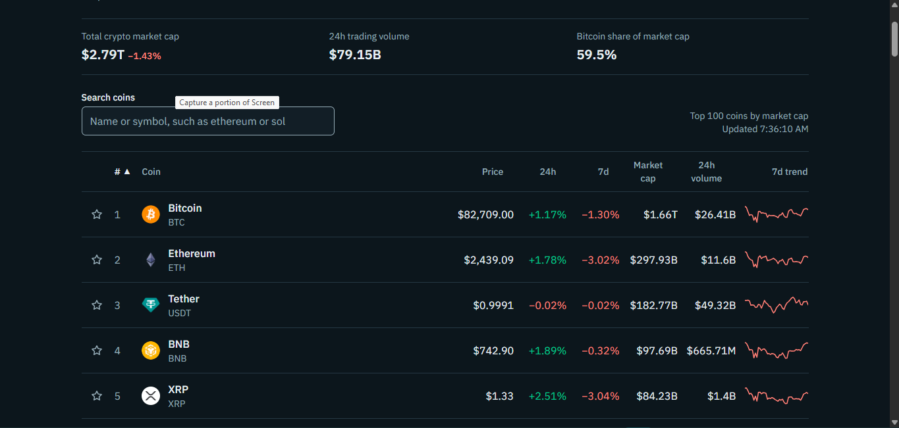
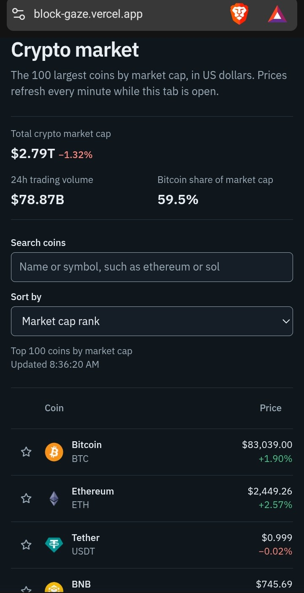

# BlockGaze

A cryptocurrency price tracker. See the top 100 coins by market cap, open any coin for its stats and price chart, and star the ones you want to keep an eye on.

**Live demo: [block-gaze.vercel.app](https://block-gaze.vercel.app/)**

<p align="center">
  
</p>

<p align="center">
  
</p>

## What it does

- **Market overview:** the top 100 coins with price, 24h and 7d change, market cap, 24h volume and a 7-day sparkline, plus total market cap, total volume and Bitcoin's share of the market.
- **Coin pages:** `/coin/[id]` shows market stats, supply, all-time high and low, and a price chart for 24h, 7d, 30d and 1y.
- **Search and sort:** filter by name or symbol as you type, and sort by any column.
- **Watchlist:** star a coin to save it. The list lives in your browser's local storage, so there are no accounts and nothing is sent to a server.
- **Refreshes every minute** while the tab is open, with loading, empty and error states for each view.
- **Privacy and Terms pages**, a custom 404, and light and dark themes that follow your system setting.

## Tech stack

| Area | Choice |
| --- | --- |
| Framework | Next.js 15 (App Router), React 19, TypeScript |
| Styling | Tailwind CSS with CSS-variable colour tokens |
| Data fetching | TanStack Query |
| Charts | Recharts, loaded only when a coin page opens |
| Data | CoinGecko API (Demo plan) |
| Hosting | Vercel |

## How it works

The browser never talks to CoinGecko. Requests go to Route Handlers under `/api/crypto/*`, which call CoinGecko from the server, validate input, shape the response and cache it for 30 to 60 seconds. This keeps the API key private and keeps the app inside the free plan's rate limits.

The home page and coin pages are Server Components that fetch their first data on the server, so the page arrives with content and search engines can read it. Client components then take over for search, sorting, the chart and the watchlist.

```
app/
  api/crypto/        Route Handlers that proxy CoinGecko
  coin/[id]/         Coin detail page
  watchlist/         Watchlist page
  privacy/, terms/   Legal pages
components/          Table, chart, search, watchlist UI
hooks/useWatchlist   localStorage-backed watchlist
lib/coingecko.ts     Server-only API client
```

## Run it locally

```bash
git clone https://github.com/QueenNatty/BlockGaze.git
cd BlockGaze
npm install
cp .env.example .env.local
npm run dev
```

Open <http://localhost:3000>.

### Environment variables

| Variable | Required | Notes |
| --- | --- | --- |
| `COINGECKO_API_KEY` | No, but recommended | Free Demo key from CoinGecko. Server-only, never exposed to the browser. |
| `COINGECKO_API_PLAN` | No | `demo` (default) or `pro`. Must match the key type. |
| `NEXT_PUBLIC_SITE_URL` | For production | Your full site address, used for the sitemap and share previews. |
| `NEXT_PUBLIC_CONTACT_EMAIL` | No | Shown on the Privacy and Terms pages. Hidden if empty. |

Without a key the app still works, but CoinGecko's keyless rate limit is low, so you may see a "rate limit reached" message with a retry button.

### Scripts

```bash
npm run dev        # development server
npm run build      # production build
npm run typecheck  # TypeScript check
npm run lint       # ESLint
```

## Known limits

- Search only covers the top 100 coins.
- Prices are in US dollars only.
- Data can be delayed and may differ from exchange prices. This is not a trading platform and nothing here is financial advice.

## Data

Market data is provided by [CoinGecko](https://www.coingecko.com/). Coin names and logos belong to their owners.

## License

Add a license before sharing the code for reuse. [MIT](https://choosealicense.com/licenses/mit/) is a common choice for portfolio projects.
